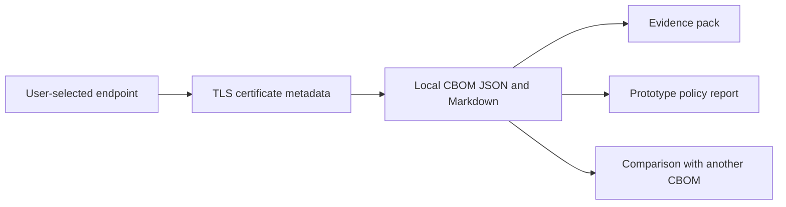

# Qyrion — architecture and scope

[Overview](../README.md) · [Verification](verification.md) · [Schema](../CBOM_SCHEMA.md)

Qyrion is a Python CLI and a separate static educational website. The CLI inspects a user-selected TLS endpoint and produces local JSON/Markdown artifacts. The website's example form is an educational preview, not a live network scanner.

## Design choices

- Standard-library Python keeps the CLI's installation surface small.
- Local structured outputs can be reviewed separately from explanatory reports.
- Evidence/policy/diff commands can work from existing sample files without contacting a host.
- Plain-language artifacts connect technical findings with planning discussions.

## Important limits

Certificate-visible information is only a partial cryptographic inventory. Prototype readiness scores and policies are application heuristics, not certifications or a validated organizational assessment. They do not establish that a host is secure, insecure, compliant, or quantum-safe.

The CLI's scan necessarily contacts the endpoint supplied by the user and uses system certificate-parsing tools. Local report generation is distinct from network-free operation. No live endpoint was scanned during this documentation review.

Roadmap ideas elsewhere in the repository are proposals, not implemented capabilities. Existing MIT licensing, security-reporting instructions, and disclaimers remain authoritative for their respective purposes.
